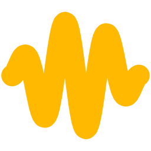
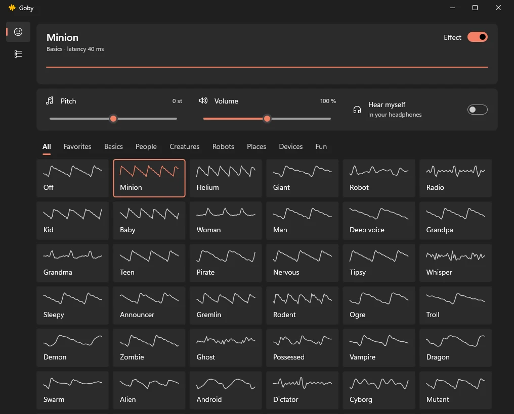
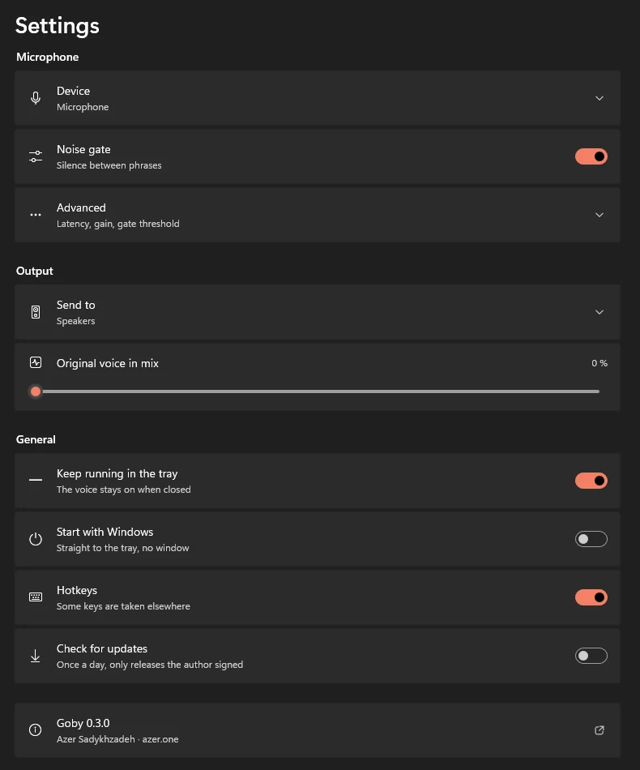

<h1 align="center">Goby</h1>

<b>A tiny voice changer for Windows.</b> 61 voices for CS2, Discord, OBS or any program you pick. One ~500 KB exe, free and open source, no account.

  
  
  
  

  <a href="https://github.com/Sadykhzadeh/goby/releases/latest"><b>Download</b></a> ·
  <a href="https://goby.azer.one/">Website</a> ·
  <a href="https://got.az/azer/goby">Source on got.az</a>

## Why Goby

- **Small and quick.** One ~520 KB executable, about 28 ms from your mouth to the game, under 1 % of one CPU core.
- **Only where you want it.** Pick CS2 or Discord on the *Programs* page and only they hear the voice. Everything else keeps your real microphone.
- **Made for playing.** Hotkeys that work inside a game, favorites, your own tuned voices, and it keeps running in the tray.
- **Nothing to sign up for.** No account, no ads, nothing sent anywhere. Updates come only from releases signed by the author.

## Get started

1. Download `goby-0.4.0-windows-x64.exe` from [Releases](https://github.com/Sadykhzadeh/goby/releases/latest) and choose **Install Goby** (or **Just run it**).
2. Goby needs the free [VB-Audio Virtual Cable](https://vb-audio.com/Cable/) to reach other programs. Without it Goby walks you through installing it and picks it up without a restart.
3. Open **Programs** and press **+** next to CS2, Discord or OBS. Done: talk.

A program with its own microphone setting (Telegram, for example) must have it on **Default** once; the Programs page tells you when one does not.

## Voices

| Group | Voices |
|---|---|
| Basics | Off, Minion, Helium, Giant, Robot, Radio |
| People | Kid, Baby, Woman, Man, Deep voice, Grandpa, Grandma, Teen, Pirate, Nervous, Tipsy, Whisper, Sleepy, Announcer |
| Creatures | Gremlin, Rodent, Ogre, Troll, Demon, Zombie, Ghost, Possessed, Vampire, Dragon, Swarm, Alien |
| Robots | Android, Dictator, Cyborg, Mutant, 8-bit, Synth choir, Hologram, Spaceship |
| Places | Cave, Cathedral, Bathroom, Stadium, Underwater, Canyon, Tin can |
| Devices | Phone, Megaphone, Walkie-talkie, Old radio, Drive-thru, Cassette |
| Fun | Squeaky choir, Opera, Choir, Karaoke, Glitch, Duet, Jet, Squeaky robot |

Every voice is a one-line recipe in [`src/voices.rs`](src/voices.rs), built from a pitch shifter, harmonies, vibrato, ring modulation, a vocoder, comb, chorus, flanger, filters, saturation, a bit crusher, echo and reverb.

## Everyday use

- **Ctrl+Alt+G** switches the effect on and off; **Ctrl+Alt+Page Down / Page Up** step through the voices, even inside a game.
- **Star** a voice (or right-click it) for the Favorites tab. Hotkeys and the tray menu then cycle only your favorites.
- Tune pitch, volume or how much of your own voice to mix in, then **Save as my voice**.
- Closing the window keeps Goby in the tray; *Start with Windows* is there, off until you turn it on.

## FAQ

**Will an anti-cheat mind it?** Goby never touches the game. It does not inject anything or read its memory; the game only sees one more microphone, made by VB-Audio's ordinary signed driver.

**Can other programs still use my microphone?** Yes. Goby shares it. *Low latency* under Settings > Advanced takes it exclusively for about 14 ms less delay, and then nothing else can record from it while Goby runs.

**Is this build really the author's?** Settings shows the version and the commit it was built from. That says which code it claims to be, not that it is genuine: check the file against `SHA256SUMS.txt` on the release page. Goby's own updater only accepts releases carrying the author's signature.

**Mac or Linux?** No, Goby is built on Windows audio and Windows UI.

## More

- [How it works](docs/how-it-works.md): audio path, latency budget, the pitch shifter, routing, measured numbers.
- [Install, update and uninstall](docs/install.md): silent install flags, what uninstall cleans up, how signed updates work.
- Build it yourself: Rust 1.88+ on Windows 10 or 11, then `cargo build --release`.

Inspired by [Clownfish Voice Changer](https://clownfish-translator.com/voicechanger/).

## License

Made by [Azer Sadykhzadeh](https://azer.one). Goby is free software under the [GNU GPL, version 3 or later](LICENSE): use it, share it and change it freely, but a changed version you give to others has to come with its source under the same license.
